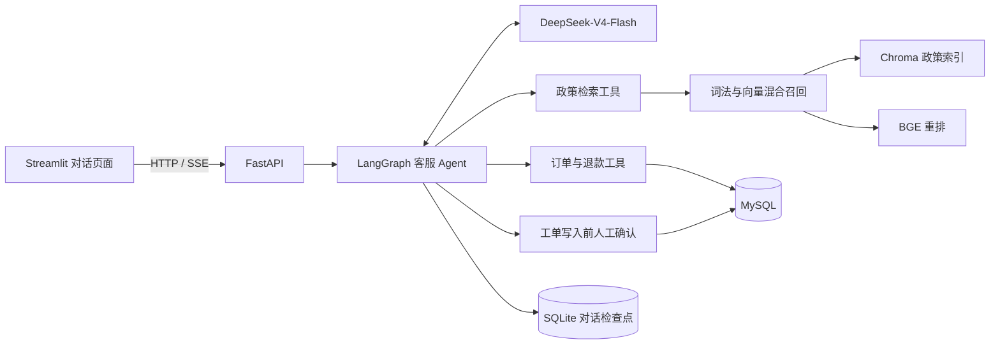

# 电商客服 Agent：订单查询、政策检索与人工工单

围绕电商售后，把自然语言对话接到可验证的业务工具上：政策问题检索知识库，订单问题
查询 MySQL，退款资格交给规则判断，创建工单则必须经过用户确认。

当前验证配置是 **DeepSeek-V4-Flash + BGE-M3 + BGE-Reranker-v2-M3 + LangGraph + FastAPI + MySQL**。
项目使用 Olist 公开匿名订单和项目构造的商城政策，适合本地学习、技术实验和作品展示。

## 先看一条业务闭环

```text
查询订单 OL099422，手机号后四位 3623
    → 校验演示身份信息，查询 MySQL 中的订单和物流状态
七天无理由退款需要满足什么条件？请标注政策来源
    → 检索商城政策，返回带文件与章节引用的回答
为订单 OL099422 创建人工客服工单，手机号后四位 3623
    → Agent 暂停，展示待执行操作
确认 / 取消
    → 确认后写入；取消则结束申请，不写入数据库
```

退款资格查询会结合订单状态和签收时间。Olist 没有拆封状态，程序不会补造这一字段，
信息不足时返回需要人工审核。

## 系统如何协作



模型负责理解表达、选择工具和组织回答；工具返回业务事实。订单、支付和商品明细走 SQL，
政策文档进入向量库，无需把全部订单转换为向量。

## 几个工程取舍

- **确认与幂等分开处理。** 人工确认解决“是否允许写入”，幂等键解决“同一申请是否已写入”。
- **业务数据和对话状态分开存储。** MySQL 保存业务表；SQLite 保存单机对话检查点。Olist SQLite 文件只是迁移中间快照。
- **保留检索对照。** 比较 lexical、dense、hybrid、hybrid_rerank 四条路径，用命中率、拒答和延迟判断重排的收益。
- **明确的失败行为。** 选定在线模型后，配置缺失会报错；嵌入、重排接口异常不会静默切换到本地模型。
- **取消是终止决定。** 工单被拒绝后直接结束本次申请，避免模型再次要求确认，同时保留后续对话能力。

## 实际验证结果

以下结果来自 **2026-10-13 本机验证**：

| 检查项 | 结果 | 证据 |
| --- | --- | --- |
| MySQL 订单与明细 | 99,441 笔订单 / 112,650 条商品明细 | [数据说明](docs/data/olist-dataset.md) |
| Docker 服务与数据检查 | 5/5 通过 | [部署记录](docs/deployment/siliconflow.md) |
| 真实在线业务验收 | 12/12 通过 | [验收报告](data/evaluation/online_acceptance_siliconflow.json) |
| Python 全量测试 | 175 通过 / 2 个原有模拟 Docker 集成测试跳过 | [测试目录](tests/) |

在线验收覆盖订单查询、政策引用、退款转人工审核、确认前零写入、确认后创建工单、重复
申请幂等、取消零写入、取消后继续对话和 SSE 流式回复。

### 政策检索对照

评测集共 72 条问题：64 条相关问题和 8 条越界问题。嵌入使用 `BAAI/bge-m3`，重排使用
`BAAI/bge-reranker-v2-m3`，均通过 API 调用。

| 检索方式 | Hit@1 | Hit@3 | 越界拒答率 | P95 检索延迟 |
| --- | ---: | ---: | ---: | ---: |
| lexical | 87.50% | 96.88% | 75.00% | 3.62 ms |
| dense | 90.62% | 98.44% | 87.50% | 109.18 ms |
| hybrid | 92.19% | 100.00% | 87.50% | 135.86 ms |
| hybrid_rerank | **96.88%** | **100.00%** | **87.50%** | 325.49 ms |

重排改善了第一命中率，也增加了网络与推理延迟。当前仍有两条相关问题第一命中有误，
一个越界问题未被拒答。结果来自固定评测集，不代表线上客服准确率；检索延迟不包含主模型
生成回复的时间。逐项结果见 [检索报告](data/evaluation/rag_report_siliconflow.json)。

## 在自己的电脑上复现

准备 Python 3.12、uv、Docker Desktop，以及上述模型的 API 访问权限和可用额度。
仓库不包含真实密钥、Olist 原始 CSV、运行数据库或模型缓存。

**安装依赖并准备配置：**

```powershell
uv python install 3.12
uv sync --frozen --python 3.12
if (-not (Test-Path .env)) {
    Copy-Item .env.siliconflow.example .env
}
```

在本机 `.env` 中填写 `SILICONFLOW_API_KEY`。主模型由 `COMPATIBLE_MODEL` 指定，
示例为 `deepseek-ai/DeepSeek-V4-Flash`，实际可用性以账号模型列表和接口返回为准。
HTTP 402 表示账户余额不足。

**准备订单并启动：**

从 [Olist 官方数据页面](https://www.kaggle.com/datasets/olistbr/brazilian-ecommerce)下载 CSV，
解压到 `data/raw/olist/`。启动 Docker Desktop 后执行：

```powershell
.\.venv\Scripts\python.exe scripts\import_olist.py --report data\raw\olist_import_report.local.json
docker compose up --build -d
.\.venv\Scripts\python.exe scripts\verify_docker.py
.\.venv\Scripts\python.exe scripts\verify_qwen_docker.py
```

导入脚本先生成 SQLite 快照，迁移容器再加载到 MySQL；迁移通过源文件 SHA-256 避免重复
导入。最后一个验收脚本保留了原文件名，当前支持所配置的在线模型，包括 DeepSeek。
在线验收会产生 API 调用费用。

- 客服页面：http://127.0.0.1:8501
- 只读数据库浏览器：http://127.0.0.1:8081
- 服务接口文档：http://127.0.0.1:8080/docs

日常停止使用 `docker compose down`，保留数据库和对话状态。
完整配置与排错见 [在线部署说明](docs/deployment/siliconflow.md)；数据字段见
[Olist 数据说明](docs/data/olist-dataset.md)。仓库也保留了 [离线学习入口](START_HERE.md) 和 Qwen 接入方式。

## 测试与实验

```powershell
.\.venv\Scripts\python.exe -m pytest -q
.\.venv\Scripts\python.exe -m ruff check
.\.venv\Scripts\python.exe scripts\evaluate_rag.py --report data\evaluation\rag_report_siliconflow.json
```

单元测试使用受控响应，不消耗真实模型额度；检索实验使用当前 `.env` 中的嵌入和重排配置，
在线配置下会产生 API 调用。GitHub Actions 执行代码风格检查、测试及容器镜像构建。

## 从哪里读代码

| 文件 | 关注点 |
| --- | --- |
| `src/agents/customer_support_agent.py` | Agent 编排、工具路由和确认中断 |
| `src/customer_support/tools.py` | 政策、订单、退款、工单四类工具 |
| `src/customer_support/rag.py` | 切片、Chroma 索引、混合召回和重排 |
| `src/customer_support/siliconflow.py` | 远程嵌入、重排的请求与响应校验 |
| `src/customer_support/mysql_store.py` | 业务查询和幂等工单 |
| `src/service/service.py` | HTTP、SSE 和对话恢复 |

排查记录包括 [政策误路由](docs/learning/bug-001-order-policy-routing.md)、
[Agent 事件处理](docs/learning/bug-002-qwen-agent-event-handling.md)、
[中文请求编码](docs/learning/bug-003-powershell-utf8-e2e.md)和
[取消工单后再次询问确认](docs/learning/bug-004-hitl-cancellation.md)。

## 数据与应用边界

Olist 提供匿名公开交易数据；演示后四位由匿名客户 ID 派生，不是真实手机号。
商城政策和客服工单是项目构造的数据。原始订单没有拆封状态，程序不会补造这一字段。

Compose 只绑定本机地址，用于单机验证。项目尚未完成独立标注集验证、并发压测、生产
监控和灾难恢复演练，不应将当前结果表述为生产上线成绩。

## 来源与许可证

服务框架基于 Joshua Carroll 的 [agent-service-toolkit](https://github.com/JoshuaC215/agent-service-toolkit)。
本仓库围绕电商业务扩展工具、政策检索、真实订单存储、人工确认、在线模型适配和验收流程。
代码遵循 [MIT License](LICENSE)，保留原作者版权声明；Olist 数据许可和来源另见数据说明。
